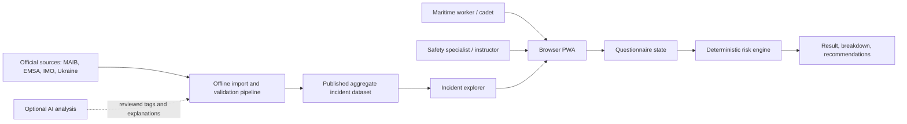
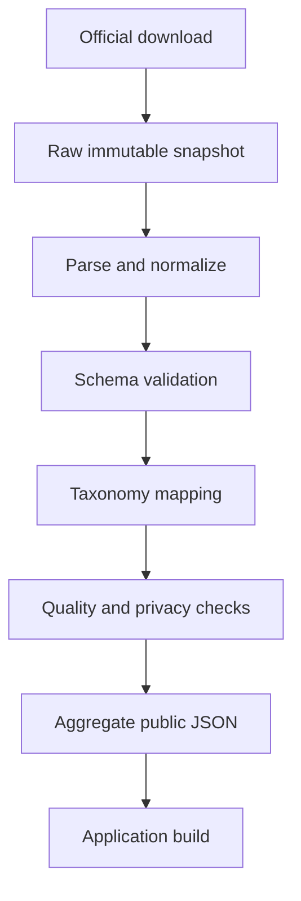

# System architecture

## Architecture goal

SeaRisk UA must remain understandable, reproducible, and inexpensive to operate. Numeric risk results are produced by a deterministic model; incident statistics provide context; optional AI may later classify or explain source material but never calculate or alter the risk value.

## System context



## Runtime boundary

The application is a static site. At runtime, the browser loads versioned assets and a bundled aggregate incident dataset. The root URL opens the assignment-first KP-965 experience; `?view=tools` exposes the extended research dashboard. Inputs and calculations stay in memory on the user's device.

```text
Browser
├── Presentation layer
│   ├── Assignment view: verified KP-965 example or custom scenario → factors → raw P / capped P × S → measures → conclusion
│   └── Optional tools view
│       ├── Questionnaire and risk result
│       └── Incident explorer
├── Domain layer
│   ├── Input validation
│   ├── Versioned coefficient registry
│   ├── Deterministic calculation
│   ├── Risk classification
│   ├── Rule-based recommendations
│   └── GISIS/ECFA case model and exports
└── Data layer
    ├── Published aggregate incidents
    └── Source and model metadata
```

No authentication, backend database, telemetry, external AI call, or runtime third-party API is required. The service worker precaches both views and their bundled modules.

## Offline data preparation

Real incident data is prepared outside the public application:



Raw records are not shipped to the browser unless their licence, privacy status, and product necessity have been reviewed.

## Core modules

| Module | Responsibility | Current state |
| --- | --- | --- |
| Questionnaire | Collect bounded profile and exposure inputs | Prototype complete |
| Risk engine | Calculate health, occupation, and lifestyle components | Provisional model |
| Classification | Map annual estimate to labelled scale | Provisional model |
| Recommendations | Produce deterministic, controllable actions | Prototype complete |
| Incident explorer | Filter MAIB affected-person counts and outcome distribution | Official aggregate v1.0 |
| Coefficient registry | Store values with units, scope, provenance, and review status | Implemented, registry `0.1.0`; coefficients remain provisional |
| Incident assignment | Guide five steps for the verified KP-965 example or an in-memory custom scenario; expose raw/capped scores and mitigation triggers; generate a conclusion; keep KP-965 ECFA and exports case-specific | Implemented in `1.2.0` |
| Import pipeline | Normalize official incident sources | MAIB CSV pipeline complete |
| Statistical layer | Rates, denominators, uncertainty, sparse-data warnings | Planned |
| Optional AI | Reviewed tagging, retrieval, grounded explanation | Deferred |

## Trust boundaries

1. **Questionnaire boundary:** potentially sensitive values must remain local by default.
2. **Model boundary:** only reviewed, versioned coefficients may enter an approved model.
3. **Source boundary:** external reports are untrusted input and must be parsed, normalized, and validated.
4. **Publication boundary:** aggregate output must not expose personal identifiers or imply unsupported precision.
5. **AI boundary:** model-generated text cannot become a numeric coefficient or an approved causal label without human review.

## Versioning

- Application: `1.2.0` (package, visible footer, release manifest, and service-worker cache identity).
- Model: independent identifier `SR-UA-PROTOTYPE-0.1` (still provisional).
- Coefficient registry: independent version `0.1.0`.
- Dataset: source and retrieval period, for example `MAIB-2021-2025@2026-10-09`.
- Taxonomy: explicit revision, for example `event-taxonomy-1.0`.

Application, model, registry, and dataset identifiers remain independent. Updating the app release must not imply model or data validation.

## Build and deployment boundary

`npm test` runs the calculation, governance, accessibility/PWA, research, AI-evaluation, and feature contracts. `npm run build` validates the public data bundle and writes a static `dist/` directory. Deployment is a separate, explicitly authorized action; no build command pushes or publishes content.

## Future backend trigger

A backend should be introduced only when a validated requirement needs one: synchronized history, organizational dashboards, controlled private datasets, or scheduled imports. Authentication and storage must not be added merely for technical convenience.

